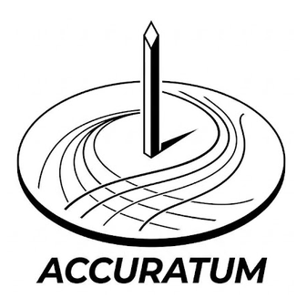
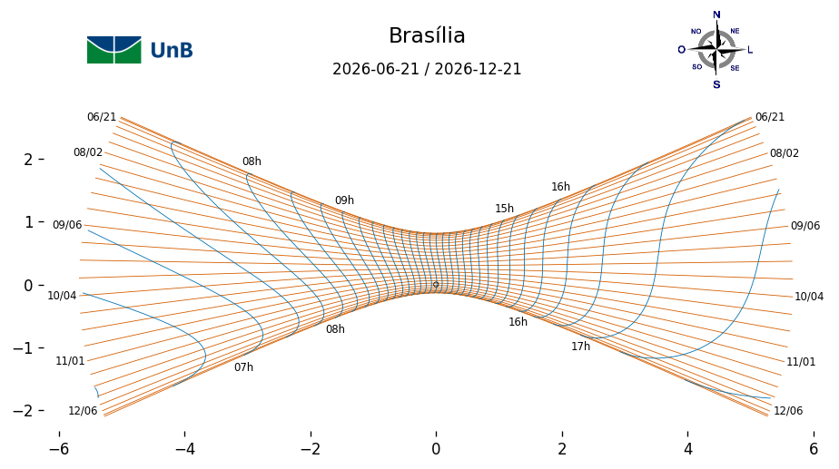

<p align="center">
  
</p>

<h1 align="center">Accuratum</h1>

<p align="center"><strong>Sundials for any place on Earth</strong></p>

<p align="center">
  🇧🇷 <a href="https://github.com/aureliobarbosa/accuratum/blob/main/README_pt-BR.md">Leia em português</a>
</p>

<p align="center">
  <a href="https://github.com/aureliobarbosa/accuratum/actions/workflows/ci.yml"></a>
  <a href="https://github.com/aureliobarbosa/accuratum/actions/workflows/deploy.yml"></a>
  <a href="https://pypi.org/project/accuratum/"></a>
  <a href="https://github.com/aureliobarbosa/accuratum/blob/main/LICENSE.md"></a>
</p>

**Make your own sundial at [accuratum.web.app](https://accuratum.web.app).**

## What is Accuratum?

For several millennia, sundials were the main way of keeping time in daily
life. They stood in squares and on buildings, and some monuments were built
just to mark the hours. Today they no longer serve a practical purpose, but
they have become something greater: works of art, and tools for teaching
and sharing science and the history of how humanity has kept time.

Accuratum lets anyone, anywhere on Earth, make a sundial for their own
neighborhood, simply and accurately. It draws a **horizontal sundial**: the
lines on which the shadow of a vertical pointer (the *gnomon*) falls,
through the hours of the day and the dates of the year, for (almost) any
place on the globe.

*Accuratum* is Latin for accurate, made with care, meticulous.

## Using the website

The easiest way to make a sundial is the website,
**[accuratum.web.app](https://accuratum.web.app)**. No installation is
needed.

1. **Choose the place.** Search for a city, university or address, or click
   the map.
2. **Personalize it.** Set the year, the title and subtitle, the line
   colors, and your own logo if you like.
3. **Generate.** It takes up to a minute.
4. **Download the PDF.** It has both halves of the year (December → June
   and June → December), ready to print.

This is the sundial for Brasília (June → December 2026):

<p align="center">
  
</p>

## Installing the program

You can also make sundials on your own computer with the `accuratum`
command. It needs [Python](https://www.python.org/) 3.11 or newer and one
of these tools: [pipx](https://pipx.pypa.io/) or
[uv](https://docs.astral.sh/uv/).

```bash
pipx install accuratum      # with pipx
uv tool install accuratum   # or with uv
```

Then make a sundial by naming a place, or by giving its latitude and
longitude:

```bash
accuratum "belem, brazil"
accuratum --lat-long=-15.78,-47.92
```

Each command creates a folder with the drawing (`accuratum.png`) inside.
To try it once without installing anything, use `uvx accuratum "belem, brazil"`.
For all the options, run `accuratum --help`.

## For developers

Detailed instructions for using Accuratum as a Python library, for the
command line and for development are in
[docs/DEVELOPERS.md](https://github.com/aureliobarbosa/accuratum/blob/main/docs/DEVELOPERS.md).

This project does not accept contributions via pull requests at this
moment. Bug reports and suggestions are welcome as
[issues](https://github.com/aureliobarbosa/accuratum/issues). If you want to
contribute to this project you can contact prof. Marco Barbosa through
LinkedIn or e-mail.

## Authors

- **Paulo Eduardo de Brito**, creator ·
  [Lattes CV](https://busca-cv-lattes.cnpq.br/curriculo/9022648500703356)
- **Marco Aurélio Alves Barbosa**, developer ·
  [Lattes CV](https://busca-cv-lattes.cnpq.br/curriculo/5720622055548812) ·
  [GitHub](https://github.com/aureliobarbosa)

## License

Accuratum is free software under the MIT license. See
[LICENSE.md](https://github.com/aureliobarbosa/accuratum/blob/main/LICENSE.md).
