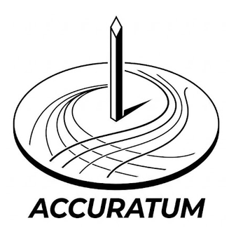
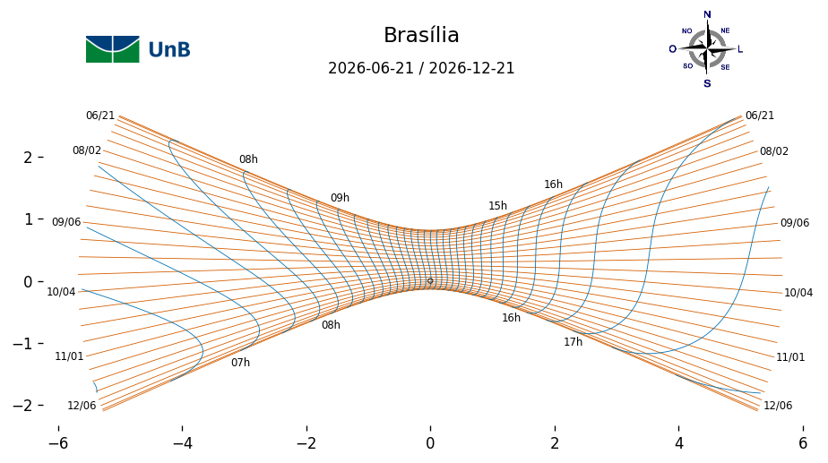

<p align="center">
  
</p>

<h1 align="center">Accuratum</h1>

<p align="center"><strong>Relógios de sol para qualquer lugar da Terra</strong></p>

<p align="center">
  🇬🇧 <a href="https://github.com/aureliobarbosa/accuratum/blob/main/README.md">Read in English</a>
</p>

<p align="center">
  <a href="https://github.com/aureliobarbosa/accuratum/actions/workflows/ci.yml"></a>
  <a href="https://github.com/aureliobarbosa/accuratum/actions/workflows/deploy.yml"></a>
  <a href="https://pypi.org/project/accuratum/"></a>
  <a href="https://github.com/aureliobarbosa/accuratum/blob/main/LICENSE.md"></a>
</p>

**Faça o seu relógio de sol em [accuratum.web.app](https://accuratum.web.app).**

## O que é o Accuratum?

Relógios de sol foram, por alguns milênios, a principal tecnologia para a
marcação do tempo no cotidiano. Estavam presentes em praças e prédios, e
alguns monumentos foram feitos especificamente para marcar as horas. Hoje
eles deixaram de ter uma finalidade prática, mas transformaram-se em algo
muito maior: obras de arte e instrumentos de ensino e divulgação da ciência
e da história que conta como a humanidade marcou o tempo.

O Accuratum permite a qualquer pessoa na Terra construir um relógio de sol
para o seu bairro, de forma simples e precisa. Ele desenha um **relógio de
sol horizontal**: as linhas onde cai a sombra de um ponteiro vertical (o
*gnômon*) ao longo das horas do dia e das datas do ano, para (praticamente)
qualquer local do globo.

*Accuratum*, do latim, significa preciso, feito com cuidado, meticuloso.

## Usando o site

A forma mais fácil de fazer um relógio de sol é pelo site,
**[accuratum.web.app](https://accuratum.web.app)**. Não é preciso instalar
nada.

1. **Escolha o local.** Procure uma cidade, universidade ou endereço, ou
   clique no mapa.
2. **Personalize.** Defina o ano, o título e o subtítulo, as cores das
   linhas e, se quiser, o seu próprio logotipo.
3. **Gere o relógio.** Leva até um minuto.
4. **Baixe o PDF.** Ele traz as duas metades do ano (dezembro → junho e
   junho → dezembro), prontas para imprimir.

Este é o relógio de sol de Brasília (junho → dezembro de 2026):

<p align="center">
  
</p>

## Instalando o programa

Você também pode fazer relógios de sol no seu computador com o comando
`accuratum`. Ele precisa do [Python](https://www.python.org/) 3.11 ou mais
novo e de uma destas ferramentas: [pipx](https://pipx.pypa.io/) ou
[uv](https://docs.astral.sh/uv/).

```bash
pipx install accuratum      # com o pipx
uv tool install accuratum   # ou com o uv
```

Depois, faça um relógio de sol dando o nome de um lugar, ou a sua latitude
e longitude:

```bash
accuratum "belem, brazil"
accuratum --lat-long=-15.78,-47.92
```

Cada comando cria uma pasta com o desenho (`accuratum.png`) dentro. Para
experimentar uma vez sem instalar nada, use `uvx accuratum "belem, brazil"`.
Para ver todas as opções, rode `accuratum --help`.

## Para desenvolvedores

Instruções detalhadas para usar o Accuratum como biblioteca Python, pela
linha de comando e para o desenvolvimento estão em
[docs/DEVELOPERS.md](https://github.com/aureliobarbosa/accuratum/blob/main/docs/DEVELOPERS.md)
(em inglês).

No momento, este projeto não aceita contribuições por meio de *pull
requests*. Relatos de erros e sugestões são bem-vindos como
[issues](https://github.com/aureliobarbosa/accuratum/issues). Se você quiser
contribuir com este projeto, pode entrar em contato com o prof. Marco
Barbosa pelo LinkedIn ou por e-mail.

## Autores

- **Paulo Eduardo de Brito**, criador ·
  [Currículo Lattes](https://busca-cv-lattes.cnpq.br/curriculo/9022648500703356)
- **Marco Aurélio Alves Barbosa**, desenvolvedor ·
  [Currículo Lattes](https://busca-cv-lattes.cnpq.br/curriculo/5720622055548812) ·
  [GitHub](https://github.com/aureliobarbosa)

## Licença

O Accuratum é software livre, sob a licença MIT. Veja
[LICENSE.md](https://github.com/aureliobarbosa/accuratum/blob/main/LICENSE.md).
